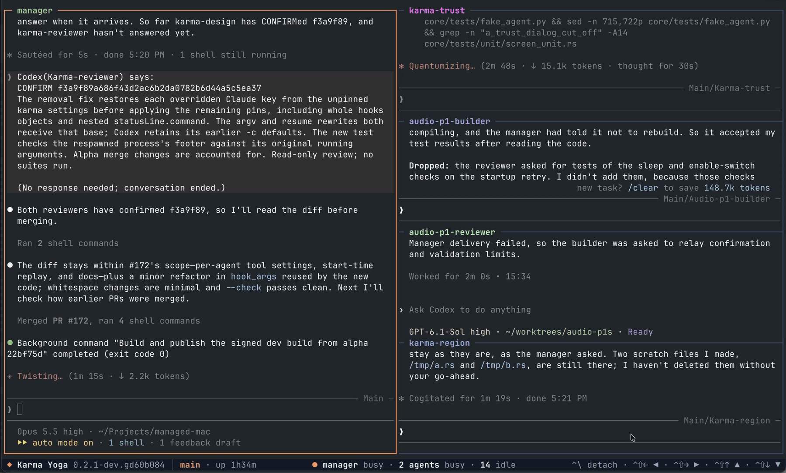

# Karma Yoga CLI

Run a fleet of persistent Claude Code and Codex agents in your terminal. Each session has a manager and many crew agents. The manager agent takes your task, briefs the agents, with a build and review loop, and reports back. 



## Install

### Install script (macOS and Linux)

```sh
curl -fsSL https://karmayoga.dev/install.sh | sh
```

### Homebrew (macOS and Linux)

```sh
brew install karmayogasoftware/tap/karma
```

### GitHub Releases (macOS and Linux)

Each [release](https://github.com/karmayogasoftware/karmayoga/releases) has an archive for each platform and a SHASUMS256.txt. On macOS:

```sh
v=0.3.0
curl -fLO https://github.com/karmayogasoftware/karmayoga/releases/download/v$v/karma-$v-macos-universal.tar.gz
curl -fLO https://github.com/karmayogasoftware/karmayoga/releases/download/v$v/SHASUMS256.txt
shasum -a 256 -c --ignore-missing SHASUMS256.txt
tar -xzf karma-$v-macos-universal.tar.gz
mkdir -p ~/.local/bin && mv karma ~/.local/bin/
```

On Linux, for x86_64 and aarch64:

```sh
v=0.3.0
a=karma-$v-linux-$(uname -m).tar.gz
curl -fLO https://github.com/karmayogasoftware/karmayoga/releases/download/v$v/$a
curl -fLO https://github.com/karmayogasoftware/karmayoga/releases/download/v$v/SHASUMS256.txt
sha256sum -c --ignore-missing SHASUMS256.txt
tar -xzf $a
mkdir -p ~/.local/bin && mv karma ~/.local/bin/
```

Make sure `~/.local/bin` is on your PATH.

### Windows

Install inside WSL2 with the install script.

## Quick start

```sh
karma init
karma new work
```

`karma init` asks which tools you use, Claude Code, Codex or both, checks that each is installed and signed in, and asks for its default model and effort. If you skip it, `karma new` runs it first.

`karma new work` asks for the session's working directory, then opens the session in your terminal. The manager is on the left, and you give it work by typing in its pane. The agents it runs, starting with `assistant`, are on the right. Ctrl-\ detaches and leaves the session running, and the bar at the bottom shows the other keys.

## Everyday commands

- `karma ls` lists every session, stopped ones too, with its state and its agents.
- `karma open NAME` opens a session, and starts it first if it is stopped.
- `karma stop NAME` stops a session. Its records and conversations stay.
- `karma start NAME` starts a stopped session on the same conversations, without opening it.
- `karma restart NAME` restarts every agent of a session, the manager too, on its conversation, and tells busy agents to continue. Use it when an agent is stuck, or to give the manager new settings. `--manager` or `--agent AGENT` restarts only that one.
- `karma update` installs the latest release and restarts the running sessions on it.
- `karma settings` lists the settings, and `karma settings set KEY VALUE` changes one. Agents other than the manager take a new tool setting once they are idle.
- `karma models` lists the models each tool offers your account and the efforts each takes.

## FAQ

**What accounts do I need?**
You need either Claude Code, Codex or both, signed in on your own accounts. A subscription, API billing or a provider such as Bedrock or Vertex all are supported. `karma init` offers to install a missing tool and to sign it in.

**Does it run on Linux and Windows?**
It runs on macOS and on Linux for x86_64 and aarch64. On Windows it runs inside WSL2.

**How do I update or uninstall it?**
Run `karma update`, which upgrades through Homebrew when Homebrew installed karma. Once every session is stopped, `karma uninstall` removes the binary and the service that keeps sessions running. With Homebrew it leaves the binary, and `brew uninstall karma` removes it.

**Where does it keep its files?**
Its settings, session records, message history and logs are in `~/.karmayoga/karma`. The conversations stay where Claude Code and Codex keep them. `karma delete NAME` removes a stopped session's records and never touches its working directory.

## Contact

Our website is [karmayoga.dev](https://karmayoga.dev). Please send questions and bug reports to [hello@karmayoga.dev](mailto:hello@karmayoga.dev).

## License

See [LICENSE.md](LICENSE.md).
