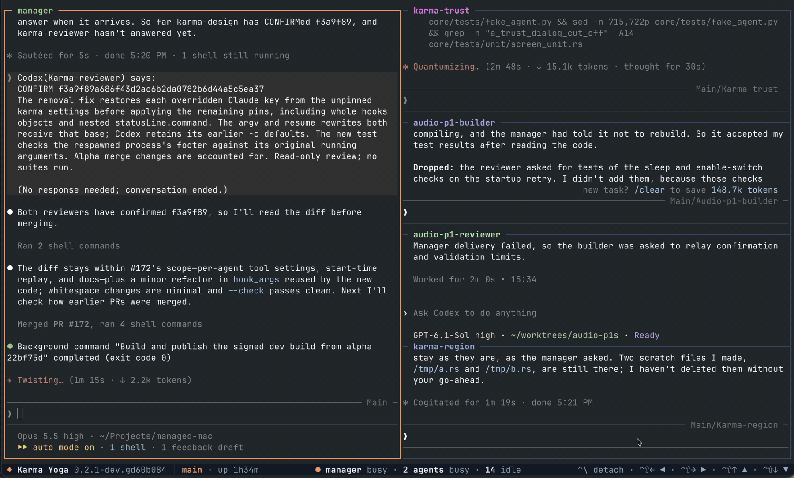

# Karma Yoga CLI

Karma Yoga CLI runs a fleet of Claude Code, Codex and Pi agents in your terminal. You talk to one manager agent. It hands the work to the other agents, has it built and reviewed, and reports back. Sessions keep going when you close the window, and agents keep their conversations across restarts.



The full guide is at [getkarmayoga.com/cli](https://getkarmayoga.com/cli/). How it works under the hood, what it sends and where it keeps its files is on [the technical details page](https://getkarmayoga.com/technical-details/).

## Install

On macOS and Linux, install with Homebrew.

```sh
brew install karmayogasoftware/tap/karma
```

Without Homebrew, run the install script.

```sh
curl -fsSL https://getkarmayoga.com/install.sh | sh
```

On Windows, Karma Yoga CLI runs through WSL2. Open PowerShell as administrator, run `wsl --install` and restart your computer. Open Ubuntu from the Start menu, choose a username and password, then run the install script inside Ubuntu.

Check that it installed with `karma --version`.

You can also have your agent install it. Paste this into Claude Code, Codex or Pi.

```text
Go to getkarmayoga.com/agent, install the Karma Yoga CLI and follow the steps to open inside a Karma Yoga session.
```

<details>
<summary>Install from GitHub Releases</summary>

Each [release](https://github.com/karmayogasoftware/karmayoga/releases) has an archive for each platform and a SHASUMS256.txt. This works on macOS (arm64 and x86_64) and Linux (x86_64 and aarch64).

```sh
v=$(curl -fsSL https://get.getkarmayoga.com/latest)
os=$(uname -s | tr A-Z a-z); [ "$os" = darwin ] && os=macos
a=karma-$v-$os-$(uname -m).tar.gz
curl -fLO https://github.com/karmayogasoftware/karmayoga/releases/download/v$v/$a
curl -fLO https://github.com/karmayogasoftware/karmayoga/releases/download/v$v/SHASUMS256.txt
grep " $a\$" SHASUMS256.txt | shasum -a 256 -c
tar -xzf $a
mkdir -p ~/.local/bin && mv karma ~/.local/bin/
```

Make sure `~/.local/bin` is on your PATH.

</details>

## Quick start

You need at least one of Claude Code, Codex or Pi, on your own account. If you already use one, `karma doctor` checks it. Otherwise install one and sign in. Use `codex` or `pi` in place of `claude`, and install more than one so each agent can run on the tool that suits its part.

```sh
karma tools install claude
karma tools login claude
karma init
karma new reports
```

`karma init` sets up this computer once, with the tools that are installed and signed in. `karma new reports` creates a session called reports in the current directory and takes you into it. The manager is on the left, and a builder, a reviewer and a copy-writer are on the right. Type in the manager's pane and give it the whole job, for example this.

```text
Add a CSV export to the reports page. Build it, test it, have it reviewed.
```

Press Ctrl-\ to detach, or close the terminal, and the work keeps going. `karma open reports` takes you back in.

## Everyday commands

- `karma ls` lists your sessions and their agents. `--all` adds archived ones.
- `karma open NAME` goes into a session, and starts it first if it is stopped.
- `karma stop NAME` stops a session. Its conversations stay, and `karma start NAME` starts it again without going in.
- `karma pause NAME` pauses an idle session and keeps its conversations and a saved screen, which is shown while the session starts again. `karma archive NAME` stops it and hides it from `karma ls`.
- `karma restart NAME` restarts every agent of a session on its conversation.
- `karma usage` shows your account limits, when they reset and what each agent used. `karma machine` shows CPU, memory and disk.
- `karma plugins list` shows the plugins you can install, such as tasks. A new setup starts with none.
- `karma update` installs the latest release and keeps your agents on their conversations.
- `karma feedback --text "What went wrong"` sends us a problem report.

## FAQ

**What accounts do I need?**
At least one of Claude Code, Codex or Pi, signed in on your own account. A subscription, API billing or a provider such as Bedrock or Vertex all work, and Karma Yoga CLI adds no cost. Pi needs Node.js 22.19 or newer and npm.

**Does it run on Linux and Windows?**
It runs on macOS (arm64 and x86_64) and on Linux (x86_64 and aarch64). On Windows it runs inside WSL2.

**How do I update or uninstall it?**
Run `karma update`, which upgrades through Homebrew when Homebrew installed it. Once every session is stopped, `karma uninstall` removes it. With Homebrew, `brew uninstall karma` then removes the binary.

**What does it send?**
Never your code, prompts or conversations, apart from the lines of an unrecognized tool prompt in a crash report. Analytics and crash reports are on by default, and `karma settings set telemetry false` turns them off. The [technical details page](https://getkarmayoga.com/technical-details/) lists everything it sends and where.

**Where does it keep its files?**
In `~/.karmayoga`. The conversations stay where Claude Code, Codex and Pi keep them. `karma delete NAME` deletes a stopped session for good and never touches your project folder.

## Contact

Our website is [getkarmayoga.com](https://getkarmayoga.com). Please send questions and bug reports to [hello@getkarmayoga.com](mailto:hello@getkarmayoga.com), or run `karma feedback --text "What went wrong"`.

## License

See [LICENSE.md](LICENSE.md).
